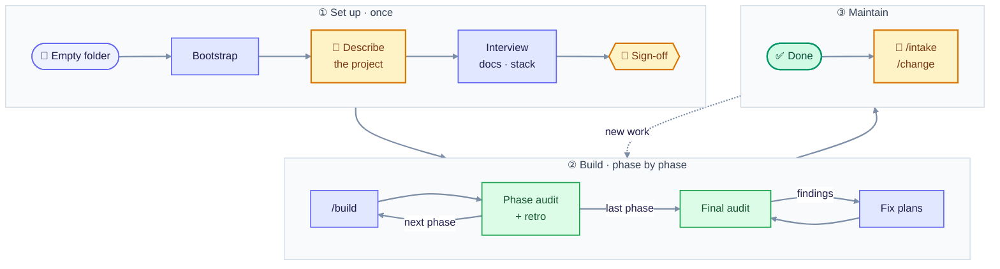
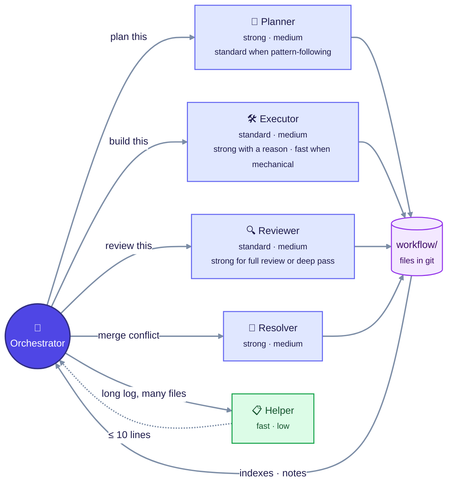
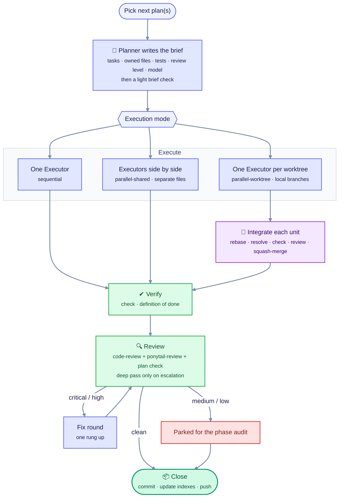
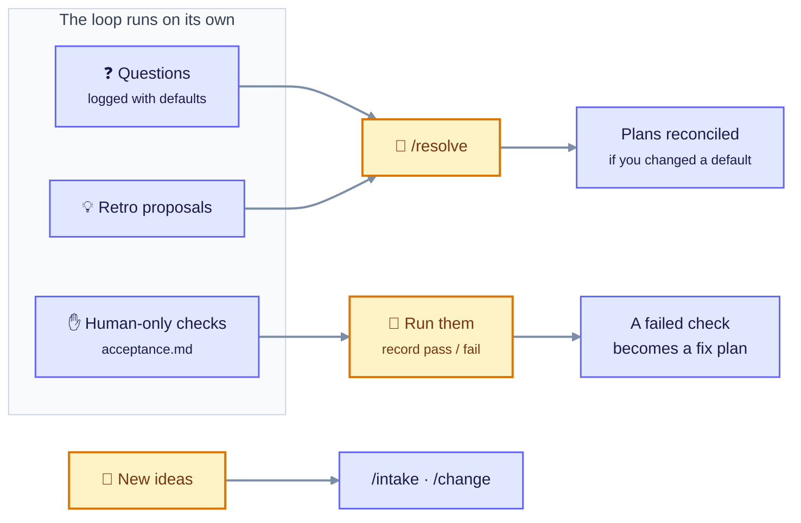
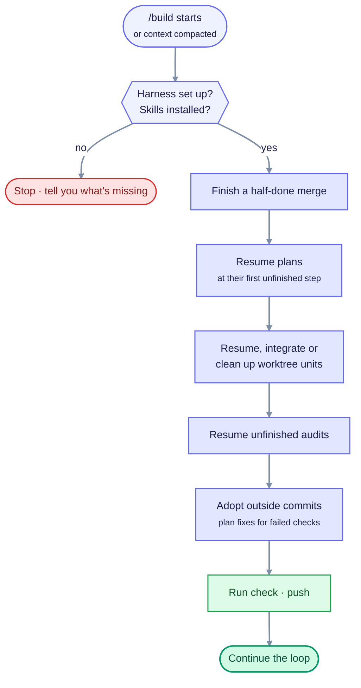
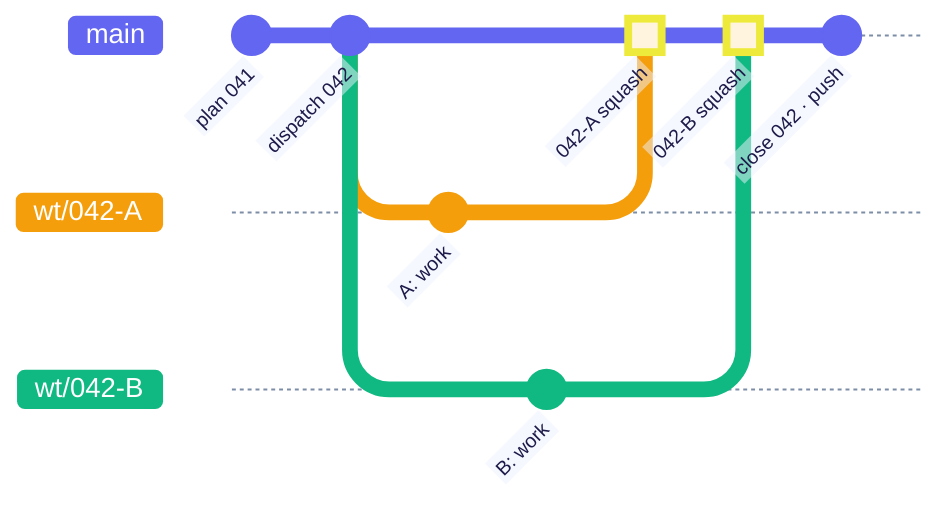

# autonomous-build-workflow

A workflow for building software with AI coding agents that work on their own for long stretches. They plan, implement, verify and review in a loop, while you steer through a few clear touchpoints. It works with any stack, platform and agent harness: Claude Code, Codex, opencode and others.

You give it a project description. It interviews you once, writes the project docs, sets up the stack, and then builds the project phase by phase. Everything it knows lives in files in the repo, so a session can stop at any moment (usage limits, crashes, closing the laptop) and pick up exactly where it left off.

- **Quick start:** [Apply it to a new project](#apply-it-to-a-new-project)
- **How it works:** [Overview](#overview)
- **Day to day:** [User guide](#user-guide)



<sub>Colours in the diagrams: 🟨 you · 🟦 agents · 🟩 checks and done · 🟪 git · 🟥 parked or stopped.</sub>

---

## Apply it to a new project

### 1. Install the required skills (once)

Install these skills at user level, for every agent harness you'll use. Search for them by name.

| Skill | What it does in the workflow |
|---|---|
| `caveman` | Terse output from every agent, so context isn't wasted on filler |
| `ponytail` | Keeps plans and code minimal: reuse first, no speculative abstractions |
| `ponytail-review` | The quality and lean half of every code review |

The workflow checks for them before it does anything else and stops if one is missing.

You also need git. Claude Code's built-in `/code-review` is used if it's available. Other harnesses fall back to a built-in review prompt.

### 2. Bootstrap

1. Create an empty folder for the project and open your agent harness there.
2. Give the agent read access to this folder. In Claude Code, approve it when asked, or add it to `additionalDirectories`. Alternatively, copy this folder into the new repo first.
3. Say: **"Bootstrap from `<path to this folder>/SPEC.md`"**
4. Answer two quick questions: which harness you're in, and whether you view the workflow in Obsidian. Then confirm which of the harness's models map to the strong, standard and fast tiers.

The agent checks the required skills, copies the workflow files into the repo, sets up your harness (commands, permissions), commits, and asks for the project description.

### 3. Describe the project

Paste a thorough description of what you want built. The agent then:

1. Saves it verbatim and lists the ambiguities, missing decisions and risks.
2. Asks you about them **in one round**, each with a recommendation.
3. Writes the overview, the phase docs and the out-of-scope list, chooses the stack (or uses yours), and probes the environment.
4. Shows you a one-page summary: phases, stack, constraints, what it can and can't verify, open questions with their defaults.

**Your sign-off here is the only approval gate.** After that, it builds on its own.

### 4. Build

Run **`/build`** in Claude Code. In other harnesses, say "Follow workflow/commands/build.md". Run it again whenever a session ends: after a usage limit, a crash, or when you come back the next day. It always resumes from where things stopped.

That's it. The rest of this README explains what happens and how to steer it.

---

## Overview

### The idea

Long-running agent work tends to fail in predictable ways: context filled up, work was lost when a session died, agents waited for answers nobody gave, bugs slipped through, and code grew bloated. This workflow is built around avoiding those failures:

- **Disk is the only memory.** Plans, progress, questions and decisions are files in git. Any session can die and the next one rebuilds the picture from the repo.
- **One thin coordinator, many disposable workers.** An *Orchestrator* picks the next work and hands it to short-lived agents that each do one job and are thrown away. The Orchestrator itself stays small and reads summaries, not code.
- **It never waits for you.** When something is unclear, it logs a question with a sensible default and keeps going. You answer when it suits you, and work is reconciled if your answer differs from the default.
- **"Done" means proven.** Every plan has to pass the project's checks, meet its acceptance criteria, and pass an independent review before it's committed.
- **Small and simple on purpose.** Agents are told to reuse before writing, avoid abstractions nobody needs, write few comments and few tests (only critical logic and end-to-end flows), and keep their output terse.

### The roles

| Role | Does | Starting tier · effort |
|---|---|---|
| **Orchestrator** | Picks work, dispatches agents, verifies, integrates, commits, pushes | your session's model (strong · medium by default) |
| **Planner** | Writes one self-contained plan brief | strong · medium; standard · medium for small or pattern-following plans |
| **Executor** | Implements one plan or slice | standard · medium; fast · low for mechanical work; strong only with a reason |
| **Reviewer** | Checks a plan brief for blockers; reviews a plan's changes, never its own code | standard · medium; strong · medium for high-risk plans; strong · high for deep passes |
| **Resolver** | Resolves merge conflicts between parallel work | strong · medium |
| **Helper** | Reads long logs or many files and returns a short summary | fast · low |

The Orchestrator picks the model and effort for each task. It starts at the cheapest setting that fits, goes higher only with a stated reason, and climbs one rung of a fixed ladder when a retry is needed.



Workers write their results to files; the Orchestrator reads only short returns and the indexes. Nothing important lives only in an agent's memory.

### The loop

For each phase of the project, the Orchestrator repeats:

1. **Pick** the next plan (or several independent plans to run in parallel).
2. **Plan:** a Planner writes the brief: goal, tasks, which files it may touch, tests, review level. A cheap Reviewer checks it for blocking problems only.
3. **Execute:** one Executor, or several in parallel, each in its own git worktree when the work splits cleanly.
4. **Verify:** run the project's `check` script and the definition of done.
5. **Review:** a fresh Reviewer runs a combined review: the harness's built-in code review plus `ponytail-review`, checked against the plan. A deeper pass on a stronger model runs only when the first pass asks for one or the change is risky. Critical and high findings get one fix round.
6. **Close:** commit, update the indexes, push.



At the end of each phase, an **audit** reviews the whole phase, turns findings into plans, and records evidence about how well the workflow itself performed (the *retro*). After the last phase, a **final audit** checks every promised feature, the README and shippability. Then the project is in maintenance.

### What it puts in your repo

Everything lives in one `workflow/` folder, so your project's own code stays uncluttered. Only `AGENTS.md` (the rulebook) and harness files like `CLAUDE.md` and `.claude/` sit at the root.

```
AGENTS.md            rules every agent follows
CLAUDE.md, .claude/  harness bindings: commands, permissions
scripts/             setup, check, check-full, run (your project's own scripts)
workflow/
  docs/              what to build: your brief, overview, one doc per phase
  plans/             one brief per plan + index
  progress/          one note per finished plan
  questions/         open and resolved questions + index
  decisions/         settled decisions + index
  audits/            phase and final audit reports
  acceptance.md      checks only you can do
  retro.md           evidence and proposals for improving the workflow
  stack.md           how to build, test and run this project
  harness.md         agent and model setup per harness
  commands/ …        the procedures the agents follow
```

---

## User guide

### Commands

| Command | When to use it |
|---|---|
| `/build` | Run the loop. Run it again after every stop. |
| `/resolve` | Answer the questions the agents logged. It goes through them one at a time, each with a recommendation. |
| `/intake` | Add new features or a batch of changes after the first build: becomes a new phase. |
| `/change` | A quick fix or tweak, done together with you in one session. |
| `/audit` | An extra audit whenever you want one (phase, final or ad hoc). |
| `/harness` | Add another agent harness, or switch to one, e.g. move from Claude Code to Codex. Run it from the new harness. |

Outside Claude Code, say "Follow workflow/commands/<name>.md" instead.

**Don't commit to the repo outside these commands.** If you do, the next `/build` notices, adopts your changes and reviews them, but it's smoother to use `/change`.

### Your touchpoints

The workflow is designed so you only need to show up for a few things:

| When | What you do | Where |
|---|---|---|
| Once, at the start | Answer the interview, sign off on the summary | the bootstrap session |
| Whenever you like | Answer logged questions | `/resolve` (open questions are in `workflow/questions/index.md`) |
| Whenever you like | Run the human-only checks, e.g. "does it look right on a real device", and record pass/fail | `workflow/acceptance.md` |
| At phase ends | Approve or decline improvement proposals from the retro (they appear as questions) | `/resolve` |
| When you want more | New features or fixes | `/intake` or `/change` |

A failed acceptance check becomes a fix plan automatically on the next `/build`. Checks marked *blocking* hold the next phase until they pass.



### When it stops, and what to do

`/build` keeps going until one of these happens. It tells you which one.

| Stop | What to do |
|---|---|
| **Final audit clean** | Done. A summary is in `workflow/progress/complete.md`. Use `/intake` or `/change` for more. |
| **Nothing actionable** | Everything left waits on you: run `/resolve`, or do the blocking acceptance checks. |
| **Usage or context running low** | Wait for your limits to reset, then `/build` again. |
| **Missing requirement** | Install the skill it names, then `/build`. |
| **Unknown harness** | You opened the project in a harness that isn't set up yet. Run `/harness` from it. |
| **Session budget reached** | Only with automatic resume on: the loop starts a fresh session by itself. |

If a session dies without a clean stop (crash, cutoff), just run `/build`. It resumes interrupted plans, reviews and merges from disk:



### Following progress

- **Quick status:** `workflow/plans/index.md` (plans and phases) and `workflow/questions/index.md`.
- **What was built:** the progress notes in `workflow/progress/`, one per plan.
- **Git history:** one commit per plan (or per parallel slice), tagged `(plan NNN)`, `(audit)` and so on.
- **Obsidian (optional):** open `workflow/` as a vault. You get a readable graph (overview → phases → plans → progress, with decisions and questions attached) and a status dashboard (`workflow/dashboard.base`).

### Running in parallel

Most plans run one at a time. When work splits cleanly (separate files, enough work in each part), the Orchestrator runs parts in parallel: either several agents in the same folder for small parts, or separate git worktrees for bigger ones. All merging happens locally, and only one branch (`main` by default) is ever pushed, so you get no pull requests and no extra branches on the remote.



### Costs and limits

- Every dispatch starts at the cheapest model and effort that fits (fast tier for log triage and mechanical edits, standard tier at medium effort for most building and reviewing; nothing above strong at high effort). Going higher needs a stated reason, which lands in the progress note, and each audit's retro counts the model mix so you can tune the starting points.
- Scripts are quiet: a passing `check` prints one line, not a full test log.
- The Orchestrator keeps its own context small and, after a context compaction, re-reads the state from disk instead of trusting its memory.
- **Automatic resume** (off by default): a shell loop or scheduled task can restart `/build` after each usage reset. Turn it on in `workflow/harness.md` once a few supervised runs look right. It spends quota while you're away.

### Safety

- Agents run with a permissions baseline: they can run the project's scripts, use git in the repo and edit files. Force pushes, hard resets, `rm -rf`, reading credentials and `sudo` are denied, and editing the permission file itself always asks.
- The workflow never changes its own rules, review levels or required skills on its own. Improvements from the retro are proposals you approve or decline.

### Switching harness

Open the project in the new harness, for example Codex, and run "Follow workflow/commands/harness.md". It checks the skills there, asks which models map to strong / standard / fast, probes what the harness can do, writes its bindings and permissions, and commits. From then on, `/build` (or its equivalent) works there too, and work in progress from the other harness is picked up normally.

### Improving the workflow

Each project's `workflow/retro.md` collects evidence: bugs that got past review, repeated problems, friction, and ideas for new skills. Proposals that would help any project collect under "For the workflow", and the final audit ranks them. Read those across a few projects when you revise this folder.

---

## This folder

| Path | What it is |
|---|---|
| `README.md` | for humans (this guide). Bootstrap ignores it. |
| `SPEC.md` | the full specification the bootstrap agent follows. It's copied into each project as `workflow/WORKFLOW.md`. |
| `template/` | the files copied into every new project |
| `bindings/` | ready-made harness files (Claude Code commands, review skill stub, permissions) |
