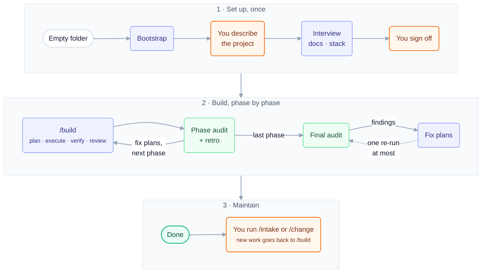
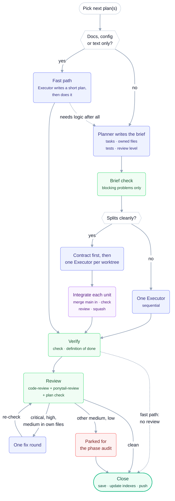
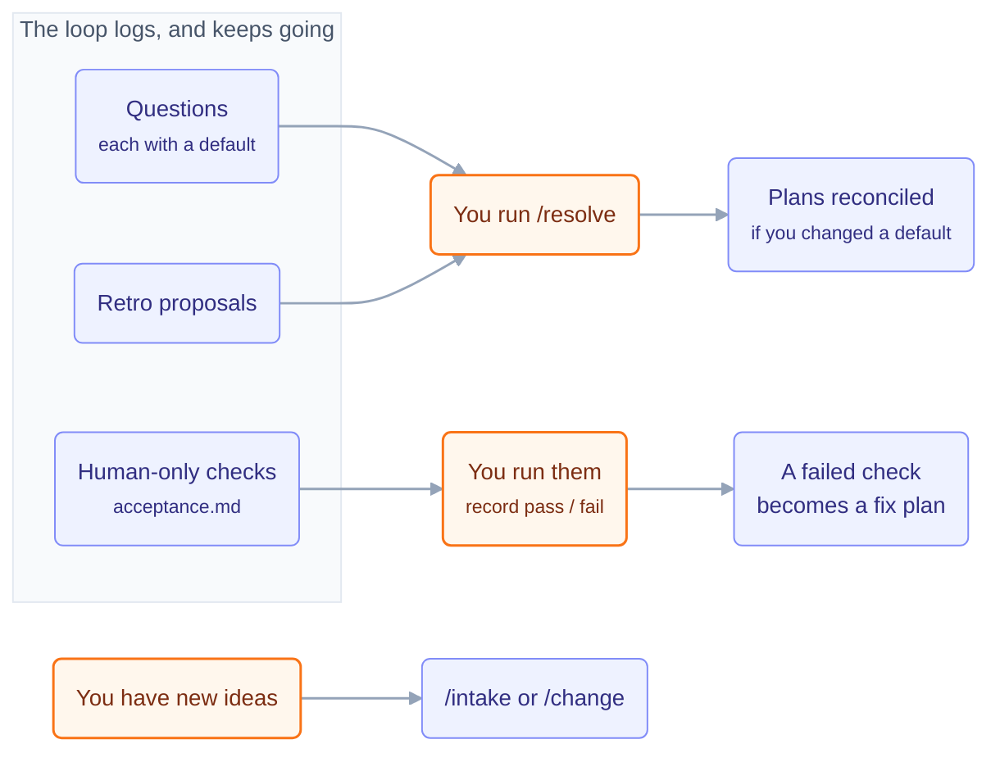
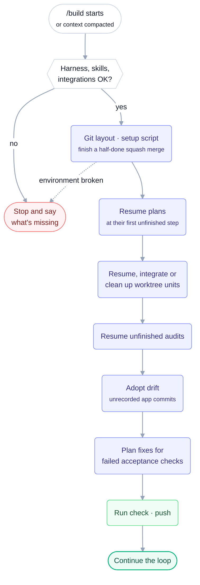
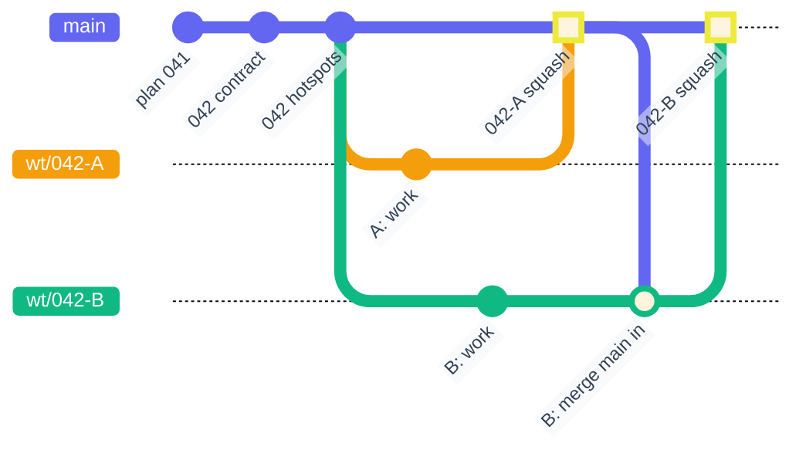
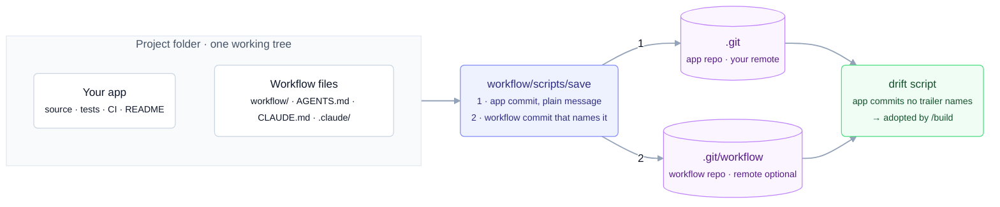

# elrond

A workflow for building software with AI coding agents that work on their own for long stretches. They plan, implement, verify and review in a loop, while you steer through a few clear touchpoints. It works with any stack, platform and agent harness: Claude Code, Codex, opencode and others.

You give it a project description. It interviews you once, writes the project docs, sets up the stack, and then builds the project phase by phase. Everything it knows lives in files in the project folder, so a session can stop at any moment (usage limits, crashes, closing the laptop) and pick up exactly where it left off.

- **Quick start:** [Apply it to a new project](#apply-it-to-a-new-project)
- **How it works:** [Overview](#overview)
- **Day to day:** [User guide](#user-guide)



<sub>Colours in the diagrams: 🟧 you · 🟦 agents (darkest: the Orchestrator) · 🟩 checks and done · 🟪 git · 🟥 parked or stopped.</sub>

---

## Apply it to a new project

### 1. Install the required skills (once)

Install these skills at user level, for every agent harness you'll use.

| Skill | What it does in the workflow | Get it |
|---|---|---|
| `caveman` | Terse output from every agent, so context isn't wasted on filler | [JuliusBrussee/caveman](https://github.com/JuliusBrussee/caveman) |
| `ponytail` | Keeps plans and code minimal: reuse first, no speculative abstractions | [DietrichGebert/ponytail](https://github.com/DietrichGebert/ponytail) |
| `ponytail-review` | The quality and lean half of every code review | same repo as `ponytail` |

The workflow checks for them before it does anything else and stops if one is missing.

You also need git. Claude Code's built-in `/code-review` is used if it's available. Other harnesses fall back to a built-in review prompt.

If your own user-level agent instructions say things like "never commit unless asked" or "plan first and wait for my go-ahead", add an exception there for this workflow's commands. The project's `AGENTS.md` declares one, but agents trust your own file more.

Technology skills from [`../skills/`](../skills/) are optional and need no install. During the interview, bootstrap picks the ones that match your stack from their descriptions, copies them into `workflow/skills/` (pinned per project) and lists them in `workflow/harness.md`. Plans name the ones their Executor loads. If none match, nothing changes.

### 2. Bootstrap

1. Create an empty folder for the project and open your agent harness there.
2. Give the agent read access to this folder. In Claude Code, approve it when asked, or add it to `additionalDirectories`. Alternatively, copy this folder into the new repo first.
3. Say: **"Bootstrap from `<path to this folder>/SPEC.md`"**
4. Say whether you view the workflow in Obsidian. Then confirm which of the harness's models map to the strong, standard and fast tiers.

The agent checks the required skills, copies the workflow files into the repo, sets up your harness (commands, permissions), sets up git so the workflow's files stay out of your project's repo, and asks for the project description.

### 3. Describe the project

Paste a thorough description of what you want built. The agent then:

1. Saves it verbatim and lists the ambiguities, missing decisions and risks.
2. Asks you about them **in one round**, each with a recommendation.
3. Writes the overview, the phase docs and the out-of-scope list, chooses the stack (or uses yours), and probes the environment.
4. Shows you a one-page summary: phases, stack, constraints, what it can and can't verify, open questions with their defaults.

**Your sign-off here is the only approval.** After that it builds on its own. The one thing that can hold a phase is a human-only check marked blocking (see [Your touchpoints](#your-touchpoints)).

### 4. Build

Run **`/build`** in Claude Code. In other harnesses, say "Follow workflow/commands/build.md". Run it again whenever a session ends: after a usage limit, a crash, or when you come back the next day. It always resumes from where things stopped.

That's it. The rest of this README explains what happens and how to steer it.

---

## Overview

### The idea

Long-running agent work tends to fail in predictable ways: context filled up, work was lost when a session died, agents waited for answers nobody gave, bugs slipped through, and code grew bloated. This workflow is built around avoiding those failures:

- **Disk is the only memory.** Plans, progress, questions and decisions are files, versioned in the workflow's own git repo. Any session can die and the next one rebuilds the picture from the repo.
- **One thin coordinator, many disposable workers.** An *Orchestrator* picks the next work and hands it to short-lived agents that each do one job and are thrown away. The Orchestrator itself stays small and reads summaries, not code.
- **It never waits for you.** When something is unclear, it logs a question with a sensible default and keeps going. You answer when it suits you, and work is reconciled if your answer differs from the default.
- **"Done" means proven.** Every plan has to pass the project's checks, meet its acceptance criteria, and pass an independent review before it's committed.
- **Small and simple on purpose.** Agents are told to reuse before writing, avoid abstractions nobody needs, write few comments and few tests (only critical logic and end-to-end flows), and keep their output terse.

### The roles

| Role | Does |
|---|---|
| **Orchestrator** | Picks work, dispatches agents, verifies, integrates, commits, pushes |
| **Planner** | Writes one self-contained plan brief |
| **Executor** | Implements one plan or slice |
| **Reviewer** | Checks a plan brief for blockers; reviews a plan's changes (never its own code) and audit sections |
| **Resolver** | Resolves merge conflicts between parallel work |
| **Helper** | Reads long logs or many files and returns a short summary |

Each role the Orchestrator dispatches follows one file in `workflow/roles/`: what it gets, what it loads, what it may write, what it never does and what it returns. The Orchestrator itself follows `workflow/commands/build.md`. To change what a role does, edit its role file. To change when it runs or at which tier, edit `build.md` (§1 holds the tiers). The roles work the same in every harness: no per-harness agent definitions are needed.

The Orchestrator picks the model and effort for each task. It starts at the cheapest setting that fits, goes higher only with a stated reason, and climbs one rung of a fixed ladder when a retry is needed. The starting points and the ladder are in [`build.md` §1](template/workflow/commands/build.md#1-dispatch-rules).

```mermaid
%%{init: {"fontFamily": "-apple-system, BlinkMacSystemFont, Segoe UI, Helvetica, Arial, sans-serif", "theme": "base", "themeVariables": {"fontFamily": "-apple-system, BlinkMacSystemFont, Segoe UI, Helvetica, Arial, sans-serif", "fontSize": "14px", "primaryColor": "#FFFFFF", "primaryBorderColor": "#CBD5E1", "primaryTextColor": "#0F172A", "lineColor": "#94A3B8", "clusterBkg": "#F8FAFC", "clusterBorder": "#E2E8F0", "edgeLabelBackground": "#FFFFFF", "tertiaryColor": "#F8FAFC"}, "flowchart": {"curve": "basis", "padding": 14}}}%%
flowchart LR
    HP("Helper<br/><small>reads long logs, many files</small>")
    O(("Orchestrator"))
    subgraph W["Disposable workers · one job each"]
        direction TB
        PL("Planner<br/><small>writes one plan brief</small>")
        EX("Executor<br/><small>builds a plan or slice</small>")
        RV("Reviewer<br/><small>checks briefs, diffs, audits</small>")
        RS("Resolver<br/><small>merge conflicts</small>")
    end
    FS[("workflow/<br/><small>files on disk</small>")]
    HP -.->|"≤ 10 lines"| O
    O -->|brief| W
    W -->|results| FS
    O <-.->|"indexes · notes"| FS

    classDef default fill:#FFFFFF,stroke:#CBD5E1,stroke-width:1px,color:#0F172A
    classDef you fill:#FFF7ED,stroke:#F97316,stroke-width:1.5px,color:#7C2D12
    classDef agent fill:#EEF2FF,stroke:#818CF8,stroke-width:1px,color:#312E81
    classDef check fill:#F0FDF4,stroke:#4ADE80,stroke-width:1px,color:#14532D
    classDef git fill:#FAF5FF,stroke:#C084FC,stroke-width:1px,color:#581C87
    classDef stop fill:#FEF2F2,stroke:#F87171,stroke-width:1px,color:#7F1D1D
    classDef done fill:#ECFDF5,stroke:#10B981,stroke-width:1.5px,color:#064E3B
    classDef lead fill:#312E81,stroke:#312E81,stroke-width:1px,color:#FFFFFF
    linkStyle default stroke-width:1.5px
    class PL,EX,RV,RS,HP agent
    class FS git
    class O lead
    style W fill:#F8FAFC,stroke:#E2E8F0,color:#475569
```



Workers write their results to files; the Orchestrator reads only short returns and the indexes. Nothing important lives only in an agent's memory.

### The loop

For each phase of the project, the Orchestrator repeats:

1. **Pick** the next plan (or several independent plans to run in parallel).
2. **Plan:** a Planner writes the brief: goal, tasks, which files it may touch, tests, review level. A cheap Reviewer checks it for blocking problems only. Docs-only, config-only and text-only work takes a fast path: the Executor writes a short plan itself, with no Planner, brief check or review.
3. **Execute:** one Executor, or several in parallel, each in its own git worktree when the work splits cleanly. Shared pieces the parallel parts all need (the plan's *Contract*) land first.
4. **Verify:** run the project's `check` script and the definition of done.
5. **Review:** a fresh Reviewer runs a combined review: the harness's built-in code review plus `ponytail-review`, checked against the plan. A deeper pass on a stronger model runs only when the first pass asks for one or the change is risky. Critical and high findings, and medium ones inside the plan's own files, get one fix round. Other mediums and lows go to the phase audit, and nits without a concrete failure aren't tracked.
6. **Close:** save (an app commit with a plain message, then a workflow commit that names it), update the indexes, push.



At the end of each phase, an **audit** reviews what changed since the previous audit, turns findings into plans, and records evidence about how well the workflow itself performed (the *retro*). The fix plans are built before the next phase starts, and the closed phase's rows move to the `archive.md` next to each index so the indexes stay short. After the last phase, a **final audit** checks every promised feature, the README and shippability. If it still finds critical or high problems, or a feature that's partial or missing, it runs once more after the fixes, never a third time. Then the project is in maintenance.

```mermaid
%%{init: {"fontFamily": "-apple-system, BlinkMacSystemFont, Segoe UI, Helvetica, Arial, sans-serif", "theme": "base", "themeVariables": {"fontFamily": "-apple-system, BlinkMacSystemFont, Segoe UI, Helvetica, Arial, sans-serif", "fontSize": "14px", "primaryColor": "#FFFFFF", "primaryBorderColor": "#CBD5E1", "primaryTextColor": "#0F172A", "lineColor": "#94A3B8", "clusterBkg": "#F8FAFC", "clusterBorder": "#E2E8F0", "edgeLabelBackground": "#FFFFFF", "tertiaryColor": "#F8FAFC"}, "flowchart": {"curve": "basis", "padding": 14}}}%%
flowchart LR
    SU(["Setup<br/><small>scope since last audit<br/>check-full gate</small>"]) --> SEC
    subgraph SEC["Sections, in parallel"]
        direction TB
        S1("Reviewer<br/><small>module A</small>")
        S2("Reviewer<br/><small>module B</small>")
    end
    SEC --> CC("Cross-cutting<br/><small>constraints · duplication<br/>tests · governance</small>")
    CC --> RP("report.md")
    RP --> PL("Fix plans<br/><small>critical / high first</small>")
    PL --> RT("Retro<br/><small>proposals become<br/>questions for you</small>")
    RT --> SV(["Save"])

    classDef default fill:#FFFFFF,stroke:#CBD5E1,stroke-width:1px,color:#0F172A
    classDef you fill:#FFF7ED,stroke:#F97316,stroke-width:1.5px,color:#7C2D12
    classDef agent fill:#EEF2FF,stroke:#818CF8,stroke-width:1px,color:#312E81
    classDef check fill:#F0FDF4,stroke:#4ADE80,stroke-width:1px,color:#14532D
    classDef git fill:#FAF5FF,stroke:#C084FC,stroke-width:1px,color:#581C87
    classDef stop fill:#FEF2F2,stroke:#F87171,stroke-width:1px,color:#7F1D1D
    classDef done fill:#ECFDF5,stroke:#10B981,stroke-width:1.5px,color:#064E3B
    classDef lead fill:#312E81,stroke:#312E81,stroke-width:1px,color:#FFFFFF
    linkStyle default stroke-width:1.5px
    class S1,S2,CC check
    class RP,PL,RT agent
    class SV git
    style SEC fill:#F8FAFC,stroke:#E2E8F0,color:#475569
```



### What it puts in your project

Everything lives in one `workflow/` folder. Only `AGENTS.md` (the rulebook) and harness files like `CLAUDE.md` and `.claude/` sit at the root. None of it ends up in your project's git repo: see [Git: your repo stays clean](#git-your-repo-stays-clean).

```
AGENTS.md            rules every agent follows
CLAUDE.md, .claude/  harness bindings: commands, permissions
workflow/
  docs/              what to build: your brief, overview, one doc per phase
  plans/             one brief per plan + index (closed phases in archive.md)
  progress/          one note per finished plan
  questions/         open and resolved questions + index (+ archive.md)
  decisions/         settled decisions + index
  audits/            phase and final audit reports
  acceptance.md      checks only you can do
  retro.md           evidence and proposals for improving the workflow
  stack.md           how to build, test and run this project
  harness.md         agent and model setup per harness
  commands/ …        the procedures the agents follow
  roles/ …           what each dispatched agent does: planner, executor, reviewer, resolver, helper
  skills/            workflow-review, plus any technology skills picked for your stack
  scripts/           setup, check, check-full, run: quiet wrappers around your project's own commands;
                     git-setup, save, drift: the two-repo git plumbing
```

---

## User guide

### Commands

| Command | When to use it |
|---|---|
| `/build` | Run the loop. Run it again after every stop. |
| `/resolve` | Answer the questions the agents logged. It goes through them one at a time, each with a recommendation. |
| `/intake` | Add new features or a batch of changes after the first build: becomes a new phase. |
| `/change` | A quick fix or tweak, done together with you in one session. |
| `/audit` | An extra audit whenever you want one (phase, final or ad hoc). |
| `/harness` | Add another agent harness, or switch to one, e.g. move from Claude Code to Codex. Run it from the new harness. |

Outside Claude Code, say "Follow workflow/commands/<name>.md" instead.

**Don't commit to the repo outside these commands.** If you do, the next `/build` notices (no workflow commit names yours), adopts your changes and reviews them, but it's smoother to use `/change`.

### Your touchpoints

The workflow is designed so you only need to show up for a few things:

| When | What you do | Where |
|---|---|---|
| Once, at the start | Answer the interview, sign off on the summary | the bootstrap session |
| Whenever you like | Answer logged questions | `/resolve` (open questions are in `workflow/questions/index.md`) |
| Whenever you like | Run the human-only checks, e.g. "does it look right on a real device", and record pass/fail | `workflow/acceptance.md` |
| At phase ends | Approve or decline improvement proposals from the retro (they appear as questions) | `/resolve` |
| When you want more | New features or fixes | `/intake` or `/change` |

A failed acceptance check becomes a fix plan automatically on the next `/build`. Checks marked *blocking* hold the next phase until they pass.



### When it stops, and what to do

`/build` keeps going until one of these happens. It tells you which one.

| Stop | What to do |
|---|---|
| **Final audit done** | Done. A summary is in `workflow/progress/complete.md`. Use `/intake` or `/change` for more. |
| **Nothing actionable** | Everything left waits on you: run `/resolve`, or do the blocking acceptance checks. |
| **Usage or context running low** | Wait for your limits to reset, then `/build` again. |
| **Missing requirement** | Install the skill it names, then `/build`. |
| **Integration unavailable** | A tool integration the phase needs (e.g. an MCP server) isn't reachable. Follow the recovery steps it reports, then `/build`. |
| **Environment broken** | The toolchain or dependencies are missing or broken on this machine. Fix what it names, then `/build`. |
| **Unknown harness** | You opened the project in a harness that isn't set up yet. Run `/harness` from it. |
| **Plan closed** | Only in single-agent mode (a harness without sub-agents): `/build` again for the next plan or audit step. |
| **Session budget reached** | Only with automatic resume on: the loop starts a fresh session by itself. |

If a session dies without a clean stop (crash, cutoff), just run `/build`. It resumes interrupted plans, reviews and merges from disk:



### Following progress

- **Quick status:** `workflow/plans/index.md` (plans and phases) and `workflow/questions/index.md`. Rows from closed phases are in the `archive.md` next to each.
- **What was built:** the progress notes in `workflow/progress/`, one per plan.
- **Git history:** the workflow repo (`git --git-dir=.git/workflow log`) has one commit per plan (a parallel plan adds one per unit, plus its dispatch, Contract and close), tagged `(plan NNN)`, `(audit)` and so on, each naming the app commit it made, if any. Your project's history has plain commit messages only.
- **Obsidian (optional):** open `workflow/` as a vault. You get a readable graph (overview → phases → plans → progress, with decisions and questions attached) and a status dashboard (`workflow/dashboard.base`).

### Running in parallel

Most plans run one at a time. When work splits cleanly (separate files, enough work in each part), the Orchestrator runs parts in parallel, each in its own git worktree. Anything the parts share (the plan's Contract, and edits to conflict hotspots) lands on `main` first. Each finished unit then merges the latest `main` into its own branch, so conflicts are resolved, checked and reviewed inside the worktree. Then it's squash-merged as one app commit with a plain message. All merging happens locally, and only one branch (`main` by default) is ever pushed, so you get no pull requests and no extra branches on the remote. The plan's close is a workflow-only commit, and the plan numbers in the graph below live only in the workflow repo.



### Costs and limits

- Every dispatch starts at the cheapest model and effort that fits ([`build.md` §1](template/workflow/commands/build.md#1-dispatch-rules) has the starting points). Going higher needs a stated reason, which lands in the progress note, and each audit's retro counts the model mix so you can tune the starting points.
- Scripts are quiet: a passing `check` prints one line, not a full test log.
- The Orchestrator keeps its own context small, resets it after each phase audit or every few closed plans (6 by default, set in `workflow/harness.md`), and after a context compaction re-reads the state from disk instead of trusting its memory.
- **Automatic resume** (off by default): a shell loop or scheduled task can restart `/build` after each usage reset. Turn it on in `workflow/harness.md` once a few supervised runs look right. It spends quota while you're away.

### Safety

- Agents run with a permissions baseline: they can run the workflow's scripts, use git in both repos and edit files. Force pushes, hard resets, `git clean`, `git stash --all`, `rm -rf`, reading credentials and `sudo` are denied, and editing the permission file itself always asks.
- The workflow never changes its own rules, review levels or required skills on its own. Improvements from the retro are proposals you approve or decline.

### Git: your repo stays clean

Your project's repo (`.git`) holds only the application. The workflow's files (`workflow/`, `AGENTS.md`, the harness files) are tracked by a second repo in the same folder, `.git/workflow`, and your repo ignores them through `.git/info/exclude`, which is never committed. So a clone of your repo, its history and its remote show no trace of the workflow: no workflow files, no `.gitignore` lines, no plan numbers in commit messages, no workflow branches.



- **Link between the two:** each workflow commit carries an `App-Commit: <sha>` line for the app commit it made. An app commit nobody recorded is treated as a change made outside the loop: the next `/build` adopts and reviews it.
- **Workflow history:** run git on it with `git --git-dir=.git/workflow <command>` from the project root, e.g. `log`, `status`, `diff`.
- **One computer** is the default: the workflow repo has no remote, and its history lives in `.git/workflow`. Back up the folder if you care about the workflow history; your app still pushes to its own remote.
- **Continue on another computer:** add a remote for the workflow repo once (`git --git-dir=.git/workflow remote add origin <url>`, then `git --git-dir=.git/workflow push -u origin main`, and add it to `workflow/stack.md` under Git so the loop pushes it). On the other computer, clone your app and run the three lines in [SPEC.md §2](SPEC.md#2-repository-layout) (Git, Another computer) from its root.
- **Careful:** `git clean -x`, `git clean -X` and `git stash --all` treat the workflow files as ignored and remove them. Agents are denied these. If it happens, `git --git-dir=.git/workflow checkout -- .` restores the last saved state.

### Switching harness

Open the project in the new harness, for example Codex, and run "Follow workflow/commands/harness.md". It checks the skills there, asks which models map to strong / standard / fast, probes what the harness can do, writes its bindings and permissions, and saves them to the workflow repo. From then on, `/build` (or its equivalent) works there too, and work in progress from the other harness is picked up normally.

### Improving the workflow

Each project's `workflow/retro.md` collects evidence: bugs that got past review, repeated problems, friction, and ideas for new skills. Proposals that would help any project collect under "For the workflow", and the final audit ranks them. Read those across a few projects when you revise this folder.

---

## This folder

| Path | What it is |
|---|---|
| `README.md` | for humans (this guide). Bootstrap ignores it. |
| `SPEC.md` | the full specification the bootstrap agent follows. It's copied into each project as `workflow/WORKFLOW.md`. |
| `template/` | the files copied into every new project |
| `bindings/` | ready-made harness files (Claude Code commands, review skill stub, permissions) |
