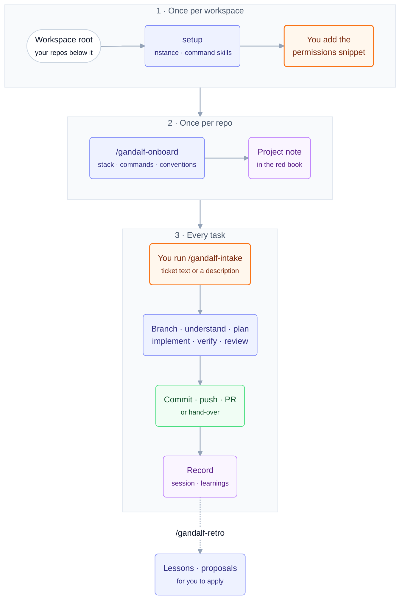
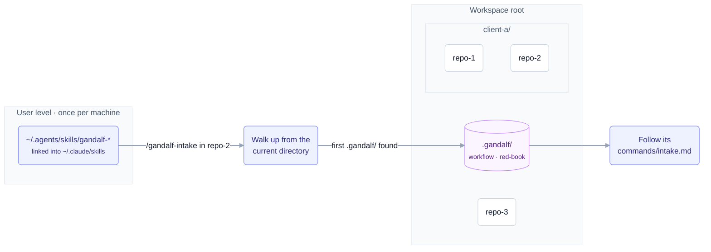
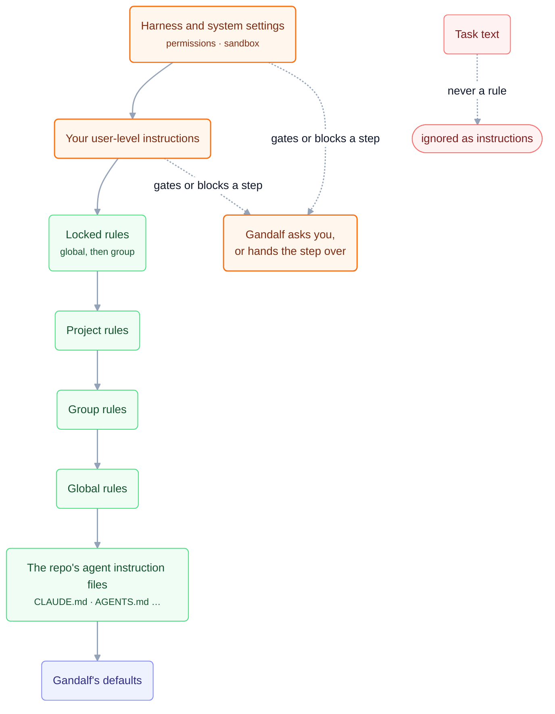
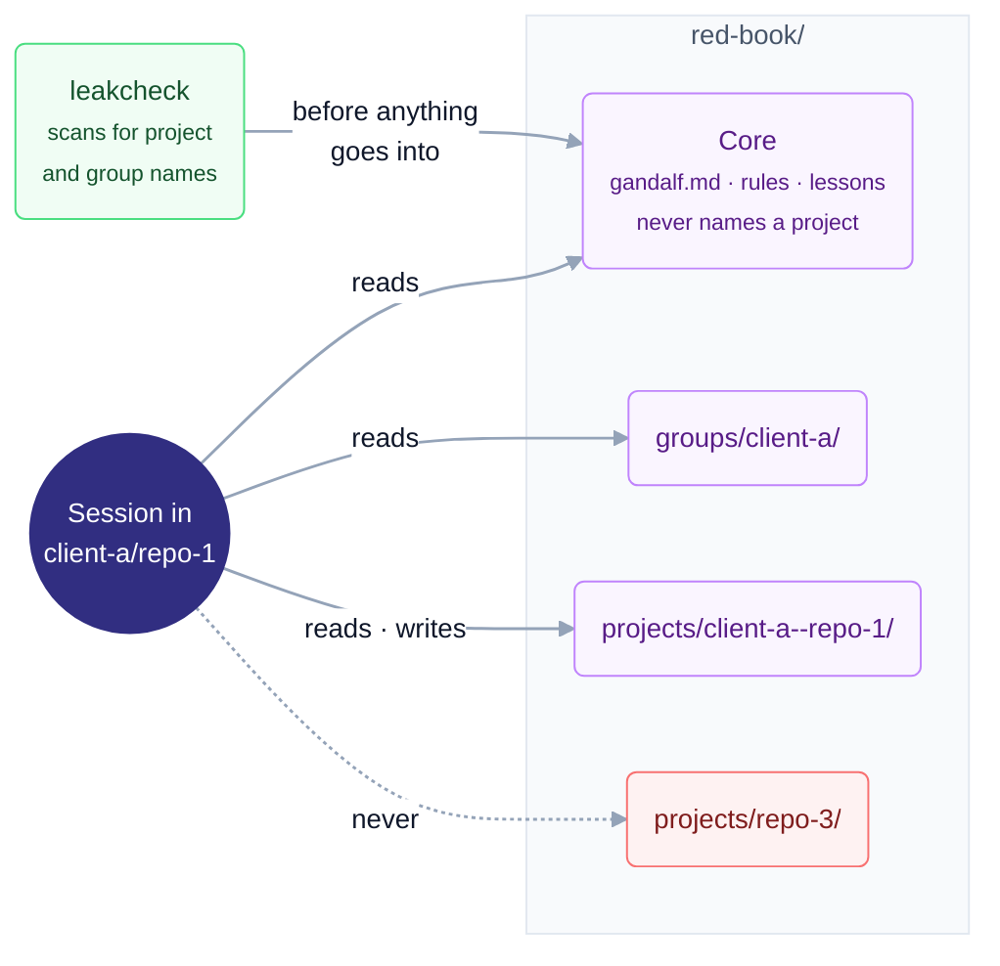
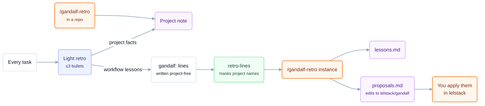

# gandalf

An agent workflow for everyday work: small and medium tasks across many repos for several clients. You install it once into a workspace folder that holds your repos. From inside any repo you give it a task (a ticket, a few lines, a long spec), and it branches, works out what's needed, implements, verifies, reviews, commits and opens a PR, then writes down what it learned. It stops to ask you when that makes the result better.

Everything gandalf knows lives in one hidden folder at the workspace root. Your repos get nothing added to them.

For long, end-to-end builds of a new project, use [elrond](../elrond/) instead. Design decisions and the reasons behind them: [DESIGN.md](DESIGN.md).



<sub>Colours in the diagrams: 🟧 you · 🟦 agents (darkest: the lead) · 🟩 checks and done · 🟪 files and git · 🟥 stopped or handed over.</sub>

## Install

### 1. Requirements
git, POSIX `sh`, and an agent harness with skills: Claude Code, Codex or opencode. Nothing else to install: the skills gandalf needs are pinned into the instance (step 5 covers using your own).

### 2. Run setup on your workspace root
The workspace root is the folder that holds, directly or nested, every repo gandalf will work in. For example, with repos in `~/projects/<client>/<repo>`:

```sh
<lelstack>/gandalf/setup ~/projects
```

It creates, and changes nothing else:
- `~/projects/.gandalf/`: the instance. `workflow/` (gandalf's procedures), `red-book/` (its memory) and `instance.conf` (version and source path). It's a local git repo for the red book's history, with no remote: commits stay on your machine.
- Six command skills, `gandalf-onboard`, `-intake`, `-rule`, `-resume`, `-retro` and `-update`, in `~/.agents/skills/` (Codex, opencode), linked into `~/.claude/skills/` (Claude Code). Each finds the instance by walking up from the directory you're in, so they work in any repo below the root at any depth, and one set serves every workspace on the machine. Outside a workspace they just say there's no instance.



Your repos get nothing. If the workspace root is itself inside a git repo, setup adds `/.gandalf/` to that repo's `.git/info/exclude`.

### 3. Let Claude Code write the red book
A session runs inside a repo, so the instance is outside its working directory and every write to it prompts. setup prints a snippet with your real paths; merge it into `~/.claude/settings.json`. For the example above it looks like this:

```json
{
  "permissions": {
    "additionalDirectories": ["/Users/you/projects/.gandalf"],
    "allow": [
      "Edit(//Users/you/projects/.gandalf/red-book/**)",
      "Write(//Users/you/projects/.gandalf/red-book/**)",
      "Bash(/Users/you/projects/.gandalf/workflow/scripts/*)"
    ]
  },
  "attribution": { "commit": "", "pr": "" }
}
```

`attribution` stops Claude Code adding its "Generated with Claude Code" line to PRs and its `Co-Authored-By` trailer to commits. Gandalf asks for neither, but the harness's own default can win over a workflow file, so the setting is the reliable switch.

The `//` in `Edit` and `Write` rules marks an absolute path. The scripts are small helpers: find the project, list sessions, read note frontmatter, scan for leaks, and `save`, which commits the instance repo (only that one, never a project, never pushed). Gandalf runs `save` as a script so it works even where your permission rules deny `git commit`; if you'd rather it didn't, add a deny rule for `Bash(<root>/.gandalf/workflow/scripts/save*)` and the instance just stays uncommitted.

### 4. Check that it works
```sh
cd ~/projects/<client>/<repo>
claude
> /gandalf-onboard
```
Onboarding reads the repo, runs its build and lint, asks what it can't work out, and writes the project note to `~/projects/.gandalf/red-book/projects/<client>--<repo>/`. Then try a small task with `/gandalf-intake <task>`.

### 5. Optional
- **Obsidian:** open `~/projects/.gandalf/red-book` as a vault for the graph and `dashboard.base` (open sessions across projects). See [The graph](#the-graph).
- **Your own `check` and `pr-text`:** gandalf prefers user-level installs over its pinned copies. To use the lelstack copies everywhere, link them: [../skills/README.md](../skills/README.md#linking-check-and-pr-text-from-lelstack).
- **ponytail, ponytail-review, caveman:** used when installed, skipped when not ([third-party skills](../skills/README.md#third-party-skills)).

### Your settings and instructions come first
Gandalf never overrides the harness's permission settings or your own user-level instructions. When one gates or blocks a step, it falls back to you:
- a denied command (say `git commit` or `git push`): it stops before that step and prints the commands and PR text, ready to run;
- an instruction that wants your approval ("never apply review findings until I pick", "plan first and wait for my go-ahead"): it asks at that step, with its recommendation;
- an instruction that forbids a step: it hands that step over and carries on with the rest.

So the same instance behaves sensibly on a locked-down machine and on one where it may push and open PRs itself.

### Another machine
Clone lelstack there and run `setup` with that machine's workspace root. The red book is local to each instance; copy `.gandalf/red-book/` across if you want the same memory.

### Uninstall
Delete `<root>/.gandalf/` (keep `red-book/` if you want the notes) and the command skills: `rm -rf ~/.agents/skills/gandalf-* ~/.claude/skills/gandalf-*`.

## Use

| Command | When |
|---|---|
| `/gandalf-onboard` | once per repo, before the first task; again whenever its setup changed |
| `/gandalf-intake <task>` | do a task. Paste the ticket text, or describe it |
| `/gandalf-rule <rule>` | add a rule for this project. `global: <rule>` or `group: <rule>` for wider ones. Also `list`, `edit <ID> <text>`, `remove <ID>`, `lock <ID>`, `unlock <ID>` |
| `/gandalf-resume [name]` | continue a task a previous session left (crash, limit, next day) |
| `/gandalf-retro` | tidy this project's notes and learn from its sessions. `/gandalf-retro instance` learns across projects |
| `/gandalf-update` | apply the current `lelstack/gandalf` to this instance |

In Codex, use `$gandalf-intake …`. In any harness you can also say "Follow `<root>/.gandalf/workflow/commands/intake.md`".

**Models.** The session you run a command in leads it: it plans, triages review findings and decides what to delegate, so run it on the strongest model you have (Opus in Claude Code). Sub-agents get their own model and effort per job: Sonnet for scouts and builders, Opus for reviews, Haiku only to pull the key lines out of long logs. The table is in [workflow/GANDALF.md](workflow/GANDALF.md) §6.

### A task, step by step
1. Loads the rules and this project's notes. Checks the working tree: uncommitted work or an existing feature branch makes it ask instead of branching.
2. Fetches and branches from the project's base branch, named by the project's convention (with the issue key if your text has one).
3. Researches the code, sizes the task and asks what's still unclear, in one round.
4. Medium and large tasks get a short plan you approve or adjust. Small ones go straight on.
5. Implements, delegating to cheaper models where they're enough. Runs the project's build, lint and tests, and fixes what breaks.
6. Reviews the diff with `check`, decides which findings are worth fixing, fixes those, and re-reviews once. What it skipped and why goes into the session notes and the report.
7. Writes the commit and PR text with `pr-text`, following the repo's conventions and PR template.
8. Asks once before pushing, then commits, pushes and opens the PR with `gh`, `az` or `glab`. If there's no CLI, or your settings or instructions don't allow a step, it prints the commands and PR text for you instead.
9. Records the session and anything worth remembering about the project.

```mermaid
%%{init: {"fontFamily": "-apple-system, BlinkMacSystemFont, Segoe UI, Helvetica, Arial, sans-serif", "theme": "base", "themeVariables": {"fontFamily": "-apple-system, BlinkMacSystemFont, Segoe UI, Helvetica, Arial, sans-serif", "fontSize": "14px", "primaryColor": "#FFFFFF", "primaryBorderColor": "#CBD5E1", "primaryTextColor": "#0F172A", "lineColor": "#94A3B8", "clusterBkg": "#F8FAFC", "clusterBorder": "#E2E8F0", "edgeLabelBackground": "#FFFFFF", "tertiaryColor": "#F8FAFC"}, "flowchart": {"curve": "basis", "padding": 14}}}%%
flowchart TD
    ST(["/gandalf-intake + task"]) --> CX("Load rules · project note<br/><small>onboard first if needed</small>")
    CX --> T{{"Clean tree<br/>on base branch?"}}
    T -->|no| AS1("Ask: continue<br/>this work, or stop")
    T -->|yes| BR("Fetch · branch<br/><small>project's naming · issue key</small>")
    AS1 -->|continue| U
    BR --> U("Understand<br/><small>scouts read the code<br/>questions in one round</small>")
    U --> SZ{{"Size?"}}
    SZ -->|small| IM
    SZ -->|"medium · large"| PL("Plan in the<br/>session file") --> AP("You approve<br/>or adjust") --> IM
    IM("Implement<br/><small>yourself, or a builder<br/>on a cheaper model</small>") --> V("Verify<br/><small>build · lint · tests</small>")
    V -->|fails| IM
    V --> RV("Review with check<br/><small>fresh reviewer</small>")
    RV --> TR("Triage<br/><small>fix what's worth it<br/>note what's skipped</small>")
    TR -->|fixes| FX("Fix · re-verify<br/>one quick re-review")
    FX --> TX
    TR -->|nothing to fix| TX("Commit and PR text<br/><small>pr-text · repo conventions</small>")
    TX --> CF("You confirm<br/>the push")
    CF --> DL("Commit · push · PR<br/><small>gh · az · glab</small>")
    TX -.->|"a rule, setting or<br/>instruction blocks it"| HO("Hand-over<br/><small>commands + PR text for you</small>")
    DL --> WR(["Record session · light retro"])
    HO --> WR

    classDef default fill:#FFFFFF,stroke:#CBD5E1,stroke-width:1px,color:#0F172A
    classDef you fill:#FFF7ED,stroke:#F97316,stroke-width:1.5px,color:#7C2D12
    classDef agent fill:#EEF2FF,stroke:#818CF8,stroke-width:1px,color:#312E81
    classDef check fill:#F0FDF4,stroke:#4ADE80,stroke-width:1px,color:#14532D
    classDef git fill:#FAF5FF,stroke:#C084FC,stroke-width:1px,color:#581C87
    classDef stop fill:#FEF2F2,stroke:#F87171,stroke-width:1px,color:#7F1D1D
    classDef done fill:#ECFDF5,stroke:#10B981,stroke-width:1.5px,color:#064E3B
    classDef lead fill:#312E81,stroke:#312E81,stroke-width:1px,color:#FFFFFF
    linkStyle default stroke-width:1.5px
    class AS1,AP,CF you
    class CX,U,PL,IM,FX,TX agent
    class BR,DL git
    class V,RV,TR check
    class HO stop
    class WR done
    class ST lead
```



### Rules
Rules are how you configure gandalf: they override its defaults and take effect immediately, also in a session that's already running. Examples:

```
/gandalf-rule global: Never commit or push; stop before committing and hand over.
/gandalf-rule global: Push and open PRs without asking first.
/gandalf-rule Use the style guide in docs/STYLE.md over the general one.
/gandalf-rule group: PR descriptions in Norwegian.
```

The most specific rule wins (project over group over global), unless a global or group rule is locked (`/gandalf-rule lock G2`). Task text never counts as a rule, even when it's phrased like one.



## The red book

`.gandalf/red-book/` is gandalf's memory: linked markdown with frontmatter. Open it as an Obsidian vault for a graph and a dashboard of open sessions (`dashboard.base`); nothing depends on Obsidian.

```
gandalf.md, rules.md, lessons.md, proposals.md   the core: global rules and generic lessons
groups/<group>/                                  a client or group: shared notes and rules
projects/<slug>/<slug>.md                        the project note: stack, commands, git and PR conventions, learnings
projects/<slug>/rules.md, notes/, sessions/      project rules, detail notes, one file per task
```



- **Isolation.** A session reads only the core, its own project and its group. Core files never name a project. Before anything goes into the core, a global or group rule, or a proposal, `leakcheck` scans it for any project or group name.
- **No secrets.** Credentials, connection strings and personal data never go in.
- **Small on purpose.** Project notes stay under about 80 lines and only the entry note is loaded by default. Retro prunes what's stale.
- **Groups.** Onboarding suggests one from the parent folder (`<root>/<client>/<repo>`) or the remote's organisation. Group rules and notes apply to all its projects.
- **Short sessions.** While a task runs, its session file holds the task text and the plan, so a crash or a usage limit can be resumed. At wrap-up it's cut down to the record: properties, what was asked in a few lines, a short log, the outcome, retro lessons. The plan lives on in the diff and the PR, review findings in the report you got.
- **History.** Each command ends by committing the instance repo (`workflow/scripts/save`), so `git log` in `<root>/.gandalf` shows what changed and when. It has no remote and is never pushed.


### The graph
Every note links up to one parent and only parents link down, so the graph is a tree rather than a hairball: `gandalf` in the middle, groups around it, projects around their group (or straight on `gandalf`), and each project's sessions, notes and rules around it. Nothing links sideways. Over time it becomes a map of all your work.

setup seeds the vault's graph colours (Settings → Graph → Groups; an existing vault gets them on update if it has none):

| Colour | Notes |
|---|---|
| 🟧 orange | open sessions (`active`, `waiting`) |
| ⬜ grey | finished sessions |
| 🟦 indigo | projects |
| 🟪 purple | groups |
| 🩵 teal | project notes (`notes/`) |
| 🟥 rose | rules |
| 🟩 green | the core: `gandalf`, `lessons`, `proposals` |

For a calmer view, filter with `-[status:done] -[status:abandoned]` to show only live work, or open the local graph on one project note.
## Updating

Run `/gandalf-update` from any repo below the root, or `<lelstack>/gandalf/setup <workspace root>` again. `workflow/` is replaced; the red book is never overwritten, only migrated when its layout changes (`migrations/`). setup first commits a snapshot of `workflow/` (and of the red book, when it's about to be migrated) and stops if it can't, so local edits to `workflow/` stay in its history. A migration gets a commit of its own, then the update another: `git log` in `<root>/.gandalf` shows each step.

## Improving gandalf

Every task ends with a light retro: project learnings go straight into the project note, and generic lessons are saved as project-free `gandalf:` lines. `/gandalf-retro instance` collects those lines into `lessons.md` and drafts changes to this folder in `proposals.md`. It never edits lelstack itself: apply what you agree with here.



## This folder

| Path | What |
|---|---|
| `setup` | bootstrap and update script |
| `workflow/` | copied into each instance as `.gandalf/workflow/`: `GANDALF.md` (operating rules), `commands/`, `roles/`, `templates/`, `scripts/` |
| `seed/` | the red book's starting files, copied only when missing |
| `stubs/` | the user-level command skills |
| `migrations/` | red book layout changes between versions |
| `VERSION` | the version recorded in each instance |
| `DESIGN.md` | decisions and deviations |
